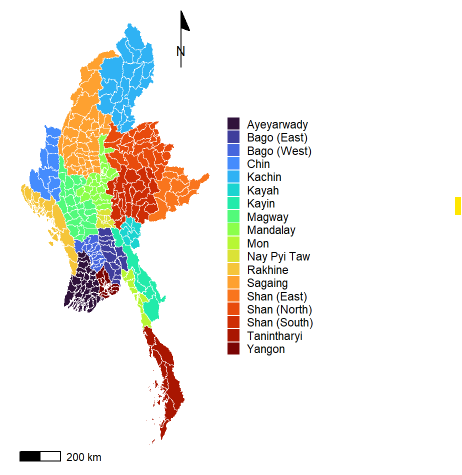
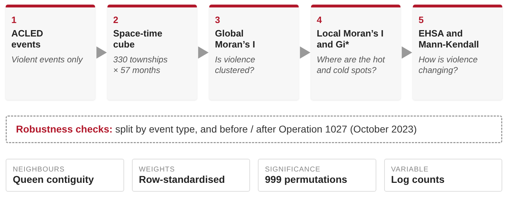
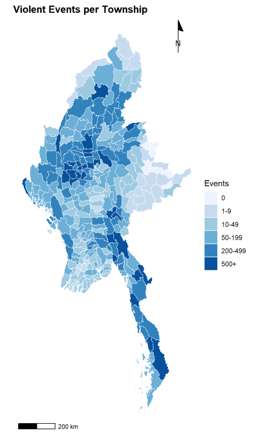
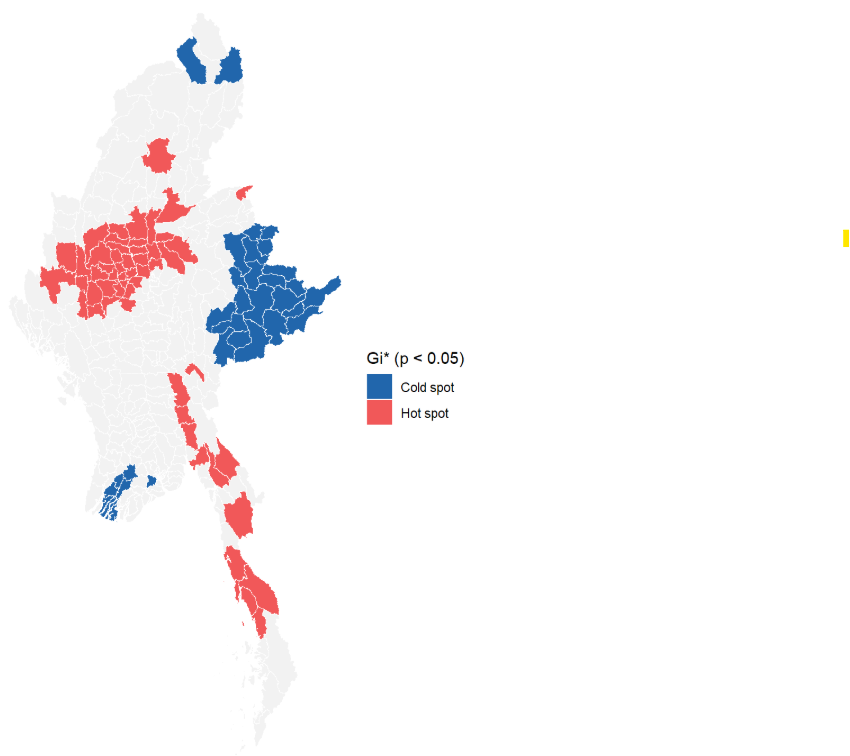
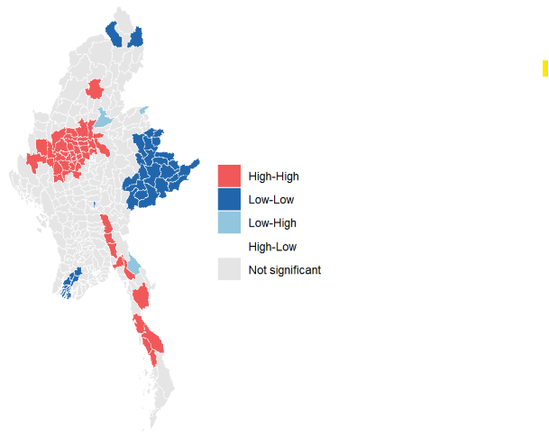
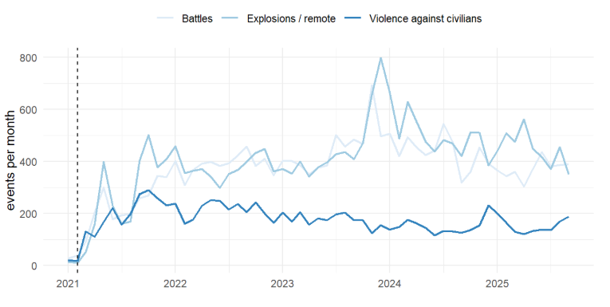
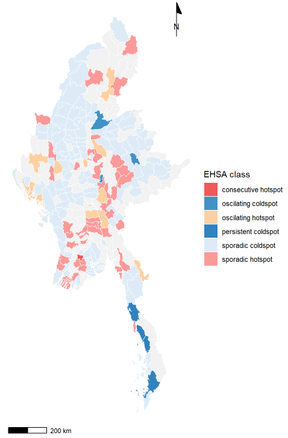
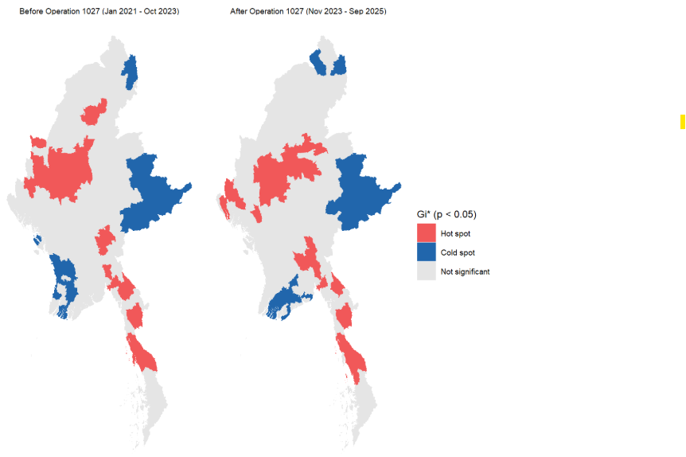

## From Burma to Myanmar {.smaller}

::: incremental
- Burma gained independence from the United Kingdom in **1948**. However, civil conflict existed right from its beginning and its early parliamentary era was relatively short-lived.

- The Karen National Union founded in 1947 began its armed struggle shortly after independence in **1948**.

- The Communist Party of Burma fought the government from **1948** to 1989, when it collapsed from internal strife.

- Ne Win's Gentleman's Coup established a military-led Caretaker Government in Burma on October 28, **1958**, commencing decades of military rule.

- The Kachin Independence Army was formed in **1961** to fight for Kachin ethnic autonomy.

- The All Burma Students’ Democratic Front was founded in **1988** after the military crushed the nationwide pro-democracy uprising in September and forced thousands of students to flee its borders.

- Burma became Myanmar on 18 June, **1988**.

- It was declared the Republic of the Union of Myanmar in **2011** after which it was governed by a civilian government until 2021.

- The 1 February, **2021** military coup was a massive catalyst that completely reshaped the country’s decades-long civil war.

  - The Kachin Independence Army and the Karen National Union shifted from localized insurgencies into pivotal drivers of a nationwide, coordinated revolution to completely topple the military junta (the State Administration Council).
  - The escalation spread rapidly to almost every major ethnic minority region and the military junta began the use of unprecedented military force on its own people.
:::

## Overview {.smaller}

Our geospatial analysis seeks to address the following questions:

1.  **Where** are the hot spots, cold spots and spatial outliers of armed conflict?
2.  **How fast and in what pattern** is violence changing over space and time?

::::: columns
::: {.column width="55%"}
- **Study Period:** January 2021 (a month before the coup) to September 2025
- **Aspatial Data:** Armed Conflict Location & Event Data Project (ACLED) data of Myanmar
- **Violent Events:** ACLED *battles*, *explosions / remote violence* and *violence against civilians* (total count: 54,004)
- **Geospatial Data:**Myanmar Township Boundaries MIMU v9.4 (total townships: 330, total state/regions: 18 )
:::

::: {.column width="45%"}
{fig-align="center" height="520"}
:::
:::::

## Analytical approach {.smaller}

{.r-stretch fig-align="center"}

## Key findings {.smaller}

**Where is violence concentrated?**

- Widespread but **strongly clustered** (Global Moran's I = 0.66, pseudo p = 0.001); **Sagaing, Magway and Mandalay** hold 42.6% of violent events (Sagaing alone 23.4%)
- **Gi\*:** 54 hot spots (a central block and a south-eastern belt along Tanintharyi) and 32 cold spots (eastern Shan, far north); Local Moran's I agrees (47 High-High, 32 Low-Low, only 3 Low-High, no High-Low)
- Battles are the most clustered event type (70 hot spots, versus 44 for explosions / remote and 42 for violence against civilians); fatalities mirror events (Spearman's rho = 0.94)

**How fast and in what pattern is violence changing?**

- Violence **rose sharply after the Feb 2021 coup** and again around **Operation 1027** (Oct 2023), then declined from early 2024 but stayed well above 2021 levels
- Hot spots barely changed in number after Operation 1027 (53 before, 51 after), but **their locations did**; there are **no persistent hot spots** (44 sporadic, 14 oscillating, 1 consecutive)
- 202 townships show a significant Gi\* trend (180 after FDR): 99 increasing, 103 decreasing, so violence is **mainly shifting between places**

## Violence is widespread but clustered

:::::: columns
::: {.column width="33%"}
{fig-align="center" height="580"}
:::

::: {.column width="33%"}
{fig-align="center" height="580"}
:::

::: {.column width="33%"}
{fig-align="center" height="580"}
:::
::::::

## Violence escalated after the coup and peaked in late 2023

{.r-stretch fig-align="center"}

**Operation 1027** (27 Oct 2023): ethnic armed groups attacked junta outposts in northern Shan State; the military responded with artillery shelling and airstrikes.

## Few stable hot spots: violence is shifting between places

::::: columns
::: {.column width="38%"}
{fig-align="center" height="650"}
:::

::: {.column width="62%"}
{fig-align="center" height="650"}
:::
:::::

## Limitations {.smaller}

**Counts, not rates.** Event counts are not adjusted for population or area, so populous townships tend to record more events. The maps show where events are recorded, not the risk per person.

**Fatalities are estimates.** ACLED codes the lowest credible figure and uses defaults of 3 when the number is unknown. Totals are therefore likely understated but this is a common issue with conflict data.

**Reporting gaps.** Access to many conflict areas is restricted and so low counts may reflect under-reporting rather than less violence. There is also likely a time lag so recent reports may be incomplete and can only be updated at a later stage.

**Unclear boundaries.** In contested areas outside state control, administration is unclear. Township boundaries are used for statistical convenience and do not reflect the situation on the ground.

**Relative measures.** Gi\* and EHSA are calculated against the national average each month. They show shifts in where violence is concentrated and shifts but not changes in its overall volume.

**Optimistic trend tests.** Monthly series are autocorrelated, which makes the trend p-values optimistic. The number of townships with a significant trend should be read as indicative.

::: aside
Sources: [ACLED Myanmar methodology](https://acleddata.com/methodology/acleds-methodology-myanmar); [Committee to Protect Journalists, 2019](https://cpj.org/blog/2019/07/myanmar-press-freedom-restricted-laws-conflict.php)
:::

## Implications for peace {.smaller}

**Conflict hot spots.** During the study period (Jan 2021 – Sep 2025), Sagaing, Magway and Mandalay hold 42.6% of violent events and are the main centres of violence. They should be a priority for humanitarian aid, although continuing fighting makes access difficult and dangerous.

**Hot spot trends.** Townships with rising Gi\* trends are where violence is becoming relatively more intense. They are candidates for early warning, civilian protection, targeted aid and closer monitoring. The trends are retrospective, not predictive, and can change as new data arrive.

**Fragmented authority.** Control is split between the military, the resistance and ethnic armed groups. After the March 2025 earthquake, ceasefires were announced but airstrikes continued, and human rights groups reported that aid was delayed or blocked in some areas. Ethnic armed groups have long called for greater autonomy or a federal system, so a lasting peace process would need to address these demands rather than rely on a single government.

**Changing geography.** Before 2021, the conflict was concentrated in the ethnic minority borderlands. Resistance to the coup has since spread it into the Bamar-majority heartland on an unprecedented scale, and violence now reaches almost all 330 townships.

**Civilian displacement.** Internal displacement has risen from about 234,000 before the coup to about 4 million by August 2026.

**Economic collapse.** The continued civil war has disrupted trade, farming and jobs, leading to a sharp rise in poverty. As state control collapsed, the illicit economy has grown and helps fund armed groups.

::: aside
Sources: [Number of internally displaced people in Myanmar](https://reliefweb.int/report/myanmar/number-internally-displaced-people-myanmar-12-oct-2026); [The Growth and Power of Myanmar's Illicit Economy](https://theowp.org/reports/the-growth-and-power-of-myanmars-illicit-economy/); [Myanmar earthquake](https://reliefweb.int/disaster/eq-2025-000043-mmr)
:::
