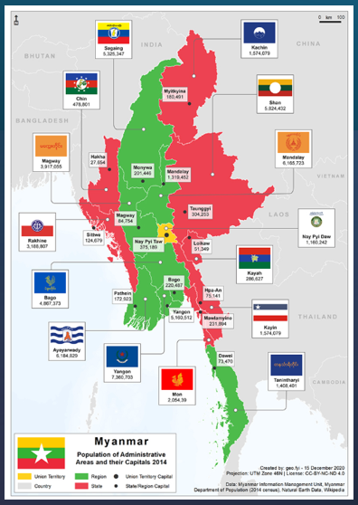

## Myanmar (Past to Present)

Burma gained independence from the United Kingdom in 1948. Its early parliamentary era was short-lived: a military caretaker government took over in 1958 and General Ne Win seized power in 1962, beginning decades of military rule. Its civil conflict existed right from the start in 1948 and has continued ever since. The Communist Party of Burma (Burma being the country’s former name) fought the government from 1948 to 1989, when it collapsed from internal strife. Ethnic minority groups have also been fighting for autonomy or independence from the central government, such as the Kachin Independence Army which was formed in 1961. The All Burma Students’ Democratic Front was founded in 1988, after the military coup of September 1988, when armed forces crushed a nationwide pro-democracy uprising and forced thousands of students to flee to countries along its borders. The military junta changed the country’s English name to Myanmar on 18 June 1989, and it was renamed the Republic of the Union of Myanmar in 2010, with a civilian government taking office in 2011.

The 1 February 2021 military coup when the military seized power was a watershed moment in Myanmar’s history of conflict and ended the decade of civilian government from 2011 to 2021. Demonstrations erupted across the country and violence against citizens increased sharply. The National Unity Government formed the People’s Defence Force in May 2021 and, in September 2021, declared a “people’s defensive war” against the military regime, calling citizens to arms.

## Study Parameters

### Study period

The period for our geospatial analysis is from January 2021 (one month before the 2021 military coup) to September 2025, covering the conflict evolution from protest to multi-fronted armed conflict.

### Datasets

The following geospatial and aspatal datasets are used:

- Armed Conflict Location & Event Data Project (ACLED) data of Myanmar from 1st January 2021 to 30th September 2025.

- Myanmar Township Boundaries MIMU v9.4.

### Administrative level

The analysis is conducted at township level, the third-level administrative division unit for Myanmar.

There are a total of [330 townships](https://en.wikipedia.org/wiki/Townships_of_Myanmar) in scope.

## Research Questions

The following analysis seeks to address the following questions:

1.  Where are the hot spots, cold spots and spatial outliers of armed conflict?
2.  How fast and in what pattern is violence changing over space and time?

## Packages Used

The following R packages will be used:

```{r}
pacman::p_load(tidyverse, stringr, sf, janitor, here, sfdep,   spdep, ggspatial, gganimate, gifski, patchwork, Kendall, dbscan, scales)
```

The following settings ensure reproducible results (**set.seed()**) and avoids scientific notation in the output (**scipen**).

```{r}
set.seed(1234)
options(scipen = 999)
```

## Import Data

The geospatial file contains both English and Burmese text. The encoding is set as UTF-8 when importing so that the Burmese text can be read correctly.

```{r}
mym_ori <- st_read(dsn = "data/geospatial",
           layer = "mmr_polbnda_adm3_250k_mimu_1",
           options = "ENCODING=UTF-8")
```

Perform data sanity check. There should be 330 rows, each for a township in Myanmar.Check the coordinate reference system (CRS).

```{r}
glimpse(mym_ori)
st_crs(mym_ori)$input
```

## Data Management

### Map Theme Set-up

Set a reusable style for plotting maps for consistency.

```{r}
theme_map <- function(base = 11) {
  theme_void(base_size = base) +
    theme(plot.title = element_text(face = "bold"),
          legend.position = "right",
          plot.margin = margin(4, 4, 4, 4))
}
```

### Create List of Townships

A table is created for the three administrative levels. As townships may have common names, the P-code is used as the unique identifier.

- **clean_names()** is used to standardize column names
- **st_make_valid()** repairs invalid geometries for spatial operations.
- **transmute()** is used to manage columns.

```{r}
mym <- mym_ori %>%
  clean_names() %>%
  st_make_valid() %>%     
  transmute(
    st_pcode = st_pcode, state_region = st,   
    dt_pcode = dt_pcode, district     = dt,
    ts_pcode = ts_pcode, township     = ts    
  )
```

The MIMU file carries both English and Burmese names. Only the English names and the P-codes are kept, so that names display correctly in maps and tables and can be matched to ACLED.

#### List Townships by Name

```{r}
mym %>%
  st_drop_geometry() %>%
  arrange(state_region, district, township) %>%
  select(state_region, district, township)
```

Sanity check for duplicated township names.

```{r}
mym %>%
  st_drop_geometry() %>%
  count(township) %>%
  filter(n > 1)
```

Check that the p-codes are distinct for duplicates identified.

```{r}
mym %>%
  st_drop_geometry() %>%
  filter(township %in% c("Htantabin", "Minhla")) %>%
  arrange(township) %>%
  select(township, ts_pcode, district, state_region)
```

### Create List of States

This shows how many districts and townships are in each state / region.

```{r}
mym %>%
  st_drop_geometry() %>%
  group_by(state_region) %>%
  summarise(districts = n_distinct(dt_pcode),
            townships = n_distinct(ts_pcode)) %>%
  arrange(desc(townships)) %>%
  bind_rows(summarise(ungroup(.), state_region = "TOTAL",
                      districts = sum(districts),
                      townships = sum(townships)))
```

### Administrative Levels of Study

The below shows the boundary map study area at state/region, districts and townships level (source:Myanmar Township Boundaries MIMU v9.4).

Myanmar consists of 7 states (primarily ethnic minorities) and 7 regions (primarily Bamar ethnicity) as well as an a Union Territory ('Nay Pyi Taw'). Bago is split into East and West and Shan is split into North, South, East in the ACLED data used.

```{r}
#| fig-cap: "Administrative Levels of Study"
#| fig-width: 11
#| fig-height: 6
lvl <- function(data, id, lab, title) {
  g <- data %>% group_by({{ id }}, {{ lab }}) %>% summarise(.groups = "drop")
  ggplot(g) +
    geom_sf(aes(fill = {{ id }}), colour = "white", linewidth = .15, show.legend = FALSE) +
    scale_fill_viridis_d(option = "turbo") +
    labs(title = title) + theme_map()
}
map1 <- lvl(mym, st_pcode, state_region, "State / Region") +
  geom_sf_text(aes(label = state_region), size = 2, check_overlap = TRUE)
map2 <- lvl(mym, dt_pcode, district,     "District")
map3 <- lvl(mym, ts_pcode, township,     "Township")
map1 + map2 + map3
```

::: callout-important
Note: Some ACLED events are located offshore in the Andaman Sea and Bay of Bengal. Events that fall more than 1 km outside the township boundaries are excluded from the township-level analysis and are not shown on this map. The number of excluded events is reported in the spatial join section below.
:::

### Data Transformation

Myanmar stretches across 2 zones, 46N (western part) and 47N (eastern part). **EPSG:32646 (WGS 84 / UTM 46N)** will be used for this study. Township layer is transformed from degrees to meters.

```{r}
mym_tfm <- st_transform(mym, 32646)

st_bbox(mym_tfm)
```

```{r}
#| fig-cap: "Townships by State/Region"
ggplot(mym_tfm) +
  geom_sf(aes(fill = state_region), colour = "white", linewidth = .1) +
  scale_fill_viridis_d(option = "turbo", name = NULL) +
  annotation_scale(location = "bl") +
  annotation_north_arrow(location = "tr", style = north_arrow_minimal) +
  theme_map() + theme(legend.key.size = unit(.35, "cm"))
```

The map shows the study area, Myanmar, divided into 18 states and regions (Shan and Bago are each split into sub-regions) and 330 townships. Township size varies widely.

### Import Aspatial Data

```{r}
acled_ori <- read_csv("data/aspatial/ACLED_Data.csv",
                      show_col_types = FALSE) %>%
                      clean_names()

glimpse(acled_ori)
```

- The dataset has 87,109 rows and 31 columns where each row is a recorded conflict event.

- Each row has uses ACLED’s three-level conflict classification:

  - disorder_type \[e.g.“Political violence”\], then
  - event_type \[e.g. “Violence against civilians”\], then
  - sub_event_type \[e.g.“Armed clash”\].

- Each conflict event has up to two named actors \[e.g. PSNA: Shanni Nationalities Army vs Civilians (Myanmar)\].

### Data Cleaning

Check for duplicate events recorded in ACLED data.

```{r}
acled_ori %>%
  count(event_id_cnty) %>%
  filter(n > 1)
```

A monthly date column is added to facilitate the following analysis, which will be on a monthly basis.

```{r}
acled <- acled_ori %>%
   mutate(month = floor_date(event_date, "month"))
```

### Data Review

Check for missing coordinates.

```{r}
tibble(
  events_in_window    = nrow(acled),
  missing_coordinates = sum(is.na(acled$latitude) | is.na(acled$longitude)),
)
```

Check frequency of event type occurences.

```{r}
tibble(
  events_in_window    = nrow(acled),
  acled %>% count(event_type, sort = TRUE)
)
```

Check geographical precision of events (lower value is more precise).

```{r}
tibble(
  events_in_window    = nrow(acled),
  acled %>% count(geo_precision)
)
```

Check full list of event types.

```{r}
acled %>% count(event_type, sort = TRUE)
```

For the purpose of thsi study, strategic developments, protests and riots will be excluded from incident count as they do not constitute armed conflict.

```{r}
violent <- c("Battles", "Explosions/Remote violence", "Violence against civilians")
acled <- acled %>% mutate(is_violent = event_type %in% violent)
```

### Spatial Join Events by Coordinates

Events are converted to points and assigned to townships using recorded coordinates and transformed to EPSG:32646 (distance). A buffer distance of 1 km is set for assignment of nearest township.

```{r}
acled_pt <- acled %>%
  st_as_sf(coords = c("longitude", "latitude"), crs = 4326, remove = FALSE) %>%
  st_transform(32646)

hit <- st_intersects(acled_pt, mym_tfm)
acled_pt$ts_pcode <- map_chr(hit, \(i) if (length(i) == 0) NA_character_ else mym_tfm$ts_pcode[i[1]])
direct <- sum(!is.na(acled_pt$ts_pcode))

miss <- which(is.na(acled_pt$ts_pcode))
if (length(miss) > 0) {
  nn <- st_nearest_feature(acled_pt[miss, ], mym_tfm)
  d  <- as.numeric(st_distance(acled_pt[miss, ], mym_tfm[nn, ], by_element = TRUE))
  acled_pt$ts_pcode[miss] <- if_else(d <= 1000, mym_tfm$ts_pcode[nn], NA_character_)
}
```

The table below shows how many events were inside a township, assigned to the nearest township within 1 km, or excluded because they were outside of the defined perimeter.

```{r}
acled_pt %>%
  st_drop_geometry() %>%
  mutate(assignment = case_when(lengths(hit) > 0 ~ "Inside a township",
                                !is.na(ts_pcode) ~ "Nearest township (within 1 km)",
                                TRUE ~ "Excluded (more than 1 km from any township)")) %>%
  count(is_violent, assignment)
```

### Monthly Recorded Events per Township

This data will be used to observe changes over time during the period of study.

```{r}
startdate <- ymd("2021-01-01")
enddate   <- ymd("2025-09-30")

months <- seq(floor_date(startdate, "month"), floor_date(enddate, "month"), by = "month")

counts <- acled_pt %>%
  st_drop_geometry() %>%
  filter(!is.na(ts_pcode)) %>%
  group_by(ts_pcode, month) %>%
  summarise(
    battles     = sum(event_type == "Battles"),
    explosions  = sum(event_type == "Explosions/Remote violence"),
    vaciv       = sum(event_type == "Violence against civilians"),
    violentinc  = battles + explosions + vaciv,
    fatalities  = sum(fatalities[is_violent], na.rm = TRUE),
    .groups = "drop"
  )
```

A complete township × month grid is created so that township-months with no events are recorded as zero instead of being dropped.

```{r}
grid <- expand_grid(ts_pcode = mym_tfm$ts_pcode, month = months) %>%
  left_join(counts, by = c("ts_pcode", "month")) %>%
  mutate(across(where(is.numeric), \(x) replace_na(x, 0)),
         month_id = dense_rank(month)) %>%
  arrange(month_id, match(ts_pcode, mym_tfm$ts_pcode))
```

### Township Totals

Township totals are derived from the grid and joined to the township polygons.

```{r}
mym_sum <- mym_tfm %>%
  left_join(grid %>%
              group_by(ts_pcode) %>%
              summarise(across(c(battles, explosions, vaciv, violentinc, fatalities), sum)),
            by = "ts_pcode")
```

### Space-time Cube

A space-time cube is created from the township-by-month grid (townships × 57 months), with the event counts as attributes.

```{r}
cube <- spacetime(grid, mym_tfm %>% select(ts_pcode),
          .loc_col = "ts_pcode", .time_col = "month_id")
```

Check that the cube is complete before continuing.

```{r}
is_spacetime_cube(cube)
```

## Exploratory Data Analysis

### Distribution of Violence across Townships

```{r}
#| fig-cap: "Violent events by Township"
#| fig-width: 7
#| fig-height: 8
brks     <- c(-Inf, 0, 9, 49, 199, 499, Inf)
labs_cls <- c("0", "1-9", "10-49", "50-199", "200-499", "500+")

mym_sum <- mym_sum %>% mutate(cls = cut(violentinc, brks, labs_cls))

ggplot(mym_sum) +
  geom_sf(aes(fill = cls), colour = "white", linewidth = .08) +
  scale_fill_brewer(palette = "Blues", name = "Events", drop = FALSE) +
  annotation_scale(location = "bl") +
  annotation_north_arrow(location = "tr", style = north_arrow_minimal) +
  labs(title = "Violent Events per Township") +
  theme_map()
```

```{r}
#| fig-cap: "Map of Myanmar"
#| out-width: "70%"

```

Based on the above:

- Violence is widespread throughout the country. Very few townships recorded no violent events.

- The highest counts (500+ events) are concentrated in the central zone (Sagaing, Magway and Mandalay), which is Bamar-majority territory where armed resistance emerged after the 2021 coup, and in a south-eastern belt running down Tanintharyi.

- Other high-count areas are found in ethnic minority regions with long-running armed conflict, such as parts of Kachin, northern Shan, Rakhine and Tanintharyi. The far north of Kachin is comparatively quiet.

- Few events are recorded in eastern Shan, along the borders with China, Laos and Thailand. This may reflect lower population density, areas dominated by ceasefire-era armed groups, and restricted media access, rather than an absence of violence.

- These are raw counts, so populous townships will tend to record more events. The maps do not show the risk per person.

### Event Types & Fatalities

Three event types have been classified as 'violent' for the purpose of this study - "Battles", "Explosions/Remote violence" and "Violence against civilians".

```{r}
#| fig-width: 11
#| fig-height: 5
mym_sum %>%
  select(township, `Battles` = battles, `Explosions / remote` = explosions,
         `Violence against civilians` = vaciv) %>%
  pivot_longer(-c(township, geometry), names_to = "measure", values_to = "n") %>%
  mutate(n_cls = cut(n, c(-Inf, 0, 4, 19, 99, Inf), c("0", "1-4", "5-19", "20-99", "100+"))) %>%
  ggplot() +
  geom_sf(aes(fill = n_cls), colour = NA) +
  scale_fill_brewer(palette = "Blues", name = NULL, drop = FALSE) +
  facet_wrap(~measure, nrow = 1) +
  theme_map(9)
```

Based on the above:

- The geographical spread is broadly consistent across the 3 types of events.

- Violence against civilians events are less prevalent but more evenly spread, compared to Battles and Explosions / Remote violence events.

```{r}
#| fig-width: 7
#| fig-height: 8
brks_f <- c(-Inf, 0, 9, 49, 199, 499, Inf)
labs_f <- c("0", "1-9", "10-49", "50-199", "200-499", "500+")

mym_sum <- mym_sum %>%
  mutate(fat_cls = cut(fatalities, brks_f, labs_f))

ggplot(mym_sum) +
  geom_sf(aes(fill = fat_cls), colour = "white", linewidth = .08) +
  scale_fill_brewer(palette = "Reds", name = "Fatalities", drop = FALSE) +
  labs(title = "Fatalities Per Township") +
  theme_map()
```

Based on the above:

- Fatalities are concentrated in the central zone, where the darkest townships (\> 500+) form a connected block.

- A second belt of high fatalities runs down the southeast region, through the Kayin, Mon and Tanintharyi areas.

- Dark townships also appear in the north (Sagaing and Kachin) and along the west coast.

- The pattern closely mirrors the map of violent events (to be confirmed by Spearman's Test)

- Most townships fall in the middle classes (10 to 499), indicating that serious fatalities are widespread.

- Fatalities are raw counts and not adjusted for population or township size.

*Spearman's Test*

```{r}
cor(mym_sum$violentinc, mym_sum$fatalities, method = "spearman")
```

A high value of 0.94 indicates that the spatial pattern of fatalities largely mirrors the pattern of violent events.

### Time-Series Analysis

The following graph depicts the changes in monthly count of violent events during the study period.

```{r}
#| fig-height: 3.5
grid %>%
  group_by(month) %>%
  summarise(Battles = sum(battles), `Explosions / remote` = sum(explosions),
            `Violence against civilians` = sum(vaciv)) %>%
  pivot_longer(-month, names_to = "type", values_to = "events") %>%
  ggplot(aes(month, events, colour = type)) +
  geom_line(linewidth = .8) +
  geom_vline(xintercept = as.Date("2021-02-01"), linetype = "dashed") +
  scale_colour_brewer(palette = "Blues", name = NULL) +
  labs(x = NULL, y = "events per month") +
  theme_minimal() + theme(legend.position = "top")
```

Based on the above graph:

- Instances of all 3 violent event types rose sharply after the military coup in February 2021. The evolution from peaceful to armed resistance and the military increased use of firepower contributed to the large spikes in both battles and explosions/remote events, peaking in late 2023.

- Numbers declined from early 2024 but remained well above pre-2021 levels.

- Violence against civilians remained relatively stable and lower in count.

::: callout-important
[**Operation 1027**](https://en.wikipedia.org/wiki/Operation_1027) On 27 October 2023, ethnic armed groups joined forces and launched Operation 1027, attacking junta outposts at multiple locations in northern Shan State. The military retaliated with artillery shelling and airstrikes, inflicting heavy civilian casualties and mass displacement.

A temporary ceasefire, the Haigeng Agreement, was brokered by China. However, fighting continued and fatalities count remained above pre-2021 levels.
:::

### Space Time Cube

The top 30 townships in terms of event count are shown below.

```{r}
#| fig-height: 5.5
top30 <- mym_sum %>%
  st_drop_geometry() %>%
  slice_max(violentinc, n = 30, with_ties = FALSE) %>%
  transmute(ts_pcode, label = paste0(township, " (", state_region, ")"))

grid %>%
  inner_join(top30, by = "ts_pcode") %>%
  mutate(label = fct_reorder(label, violentinc, .fun = sum)) %>%
  ggplot(aes(month, label, fill = log1p(violentinc))) +
  geom_tile(width = 31) +
  scale_fill_distiller(palette = "Blues", direction = 1, name = "log(1+events)") +
  labs(x = NULL, y = "Township") +
  theme_minimal(base_size = 9)
```

Based on the above:

- Violence increased sharply from near-zero at the start of 2021 to almost all of the 30 townships by 2022.

- Consistently high event count dominates in the Sagaing (Monywa, Kale, Shwebo, Sagaing, Khin-U, Kanbalu, Pale, Chaung-U, Yinmarbin and Myinmu), Magway (Myaing, Yesagyo, Pakokku, Pauk) and Mandalay (Madaya, Myingyan) regions. appear too.

- Nawnghkio (northern Shan) and Maungdaw (Rakhine) started with relatively fewer violent events in the early years which increased significantly in 2024-2025.

::: callout-important
**Strategic Gateways** Townships such as Hpapun (Kayin) and Demoso (Kayah) show recurring episodes of intense fighting. Both are strategically significant and heavily contested. Hpapun is a Karen National Union (KNU) stronghold near the Thai border. Demoso, the second-largest town in Kayah (Karenni) State, lies on the corridor linking resistance areas to the north and south, and is seen as a potential launching point for attacks towards Naypyitaw.
:::

### Quarterly Analysis

A heatmap is used to show violent events by state and region for each quarter, so trends over time can be compared across regions. The range is compressed between the least and most affected regions for visibility.

```{r}
grid %>%
  left_join(mym_tfm %>% st_drop_geometry() %>% distinct(ts_pcode, state_region),
            by = "ts_pcode") %>%
  mutate(quarter = floor_date(month, "quarter")) %>%
  group_by(state_region, quarter) %>%
  summarise(n = sum(violentinc), .groups = "drop") %>%
  ggplot(aes(quarter, fct_reorder(state_region, n, .fun = sum), fill = log1p(n))) +
  geom_tile(width = 92) +
  scale_fill_distiller(palette = "Blues", direction = 1, name = "log(1+events)") +
  labs(x = NULL, y = "State / Region") +
  theme_minimal(base_size = 9)
```

Based on the above:

- Violence escalates in almost every region post-2021 coup.

```{r}
mym_sum %>%
  st_drop_geometry() %>%
  group_by(state_region) %>%
  summarise(violentinc = sum(violentinc)) %>%
  mutate(pct_events = round(100 * violentinc / sum(violentinc), 1)) %>%
  arrange(desc(violentinc))
```

- Sagaing is the epicentre the conflict during the study period (darkest blue) with the highest count recorded (12,629).

- The dark cell for Shan(North) is due to Operation 1027.

- The intensity of violence in Rakhine has escalated in the last few years.

- Note that incident counts may be high because of the number of townships in each region and is not indicative of the rates per township.

::: callout-important
**Sagaing** is the most affected region in the post-coup conflict, accounting for 23.4% of violent events recorded. Before 2021, armed conflict was concentrated in the ethnic minority borderlands. The military’s violent crackdown on protests in the largely Bamar-majority heartland led to a rapid rise in armed resistance there. The region lies between the Ayeyarwady and Chindwin rivers and stretches from the Indian border to Mandalay, which makes it important for transport and supply routes. As resistance forces held ground, the military intensified its attacks, particularly airstrikes, in what rights groups and media have described as a scorched-earth campaign.
:::

::: callout-important
Violence in **Rakhine** has intensified since the Arakan Army resumed fighting in late 2023. By late 2025, the AA controlled 14 of the Rakhine State’s 17 townships, leaving the junta holding only the coastal towns of Sittwe, Kyaukphyu and Manaung, where its regional command and naval bases are located. The military has relied on airstrikes, drones and heavy artillery to reinforce its remaining positions, together with maritime operations. It has also reportedly coordinated with Rohingya armed groups, despite the 2017 crackdown that drove hundreds of thousands of Rohingya into Bangladesh.
:::

## Global Measures of Spatial Autocorrelation

### Data Wrangling

Townships are irregular polygons so queen contiguity and row-standardised weights are used so that spatial lag of each township is an average of its neighbours. Isolated townships without contiguous neighbours are linked to their nearest centroids.

```{r}
nb_q <- st_contiguity(mym_tfm$geometry, queen = TRUE)

isolates <- which(card(nb_q) == 0)
mym_tfm$township[isolates]

if (length(isolates) > 0) {
  nb_k   <- st_knn(st_centroid(mym_tfm$geometry), k = 2)
  nb_fix <- nb_q
  for (i in isolates) nb_fix[[i]] <- as.integer(nb_k[[i]])
  nb_fix <- make.sym.nb(nb_fix)                           
} else nb_fix <- nb_q
```

```{r}
summary(card(nb_fix))                                        
```

```{r}
mym_w <- mym_sum %>%
  mutate(nb = nb_fix,
         wt = st_weights(nb, style = "W"),
         .before = 1)
```

### Global Moran's I

Global Moran’s I is used to identify if clustering exists. Significance is assessed with 999 permutations.

```{r}
set.seed(1234)
gmi_ori <- global_moran_perm(mym_w$violentinc, mym_w$nb, mym_w$wt, nsim = 999)
gmi_ori
```

```{r}
set.seed(1234)
gmi <- global_moran_perm(log1p(mym_w$violentinc), mym_w$nb, mym_w$wt, nsim = 999)
gmi

```

Global Moran’s I on log-transformed counts is 0.66 (versus 0.49), indicating significant positive spatial autocorrelation. ... The observed value exceeded all 999 permutation simulations (pseudo p = 0.001).

### Moran Scatterplot

```{r}
mym_w %>%
  st_drop_geometry() %>%
  mutate(x     = log1p(violentinc),
         z     = as.numeric(scale(x)),
         lag_z = st_lag(z, nb, wt)) %>%
  ggplot(aes(z, lag_z)) +
  geom_hline(yintercept = 0, linetype = "dashed") +
  geom_vline(xintercept = 0, linetype = "dashed") +
  geom_point(alpha = .5) +
  geom_smooth(method = "lm", se = FALSE) +
  labs(x = "Violent events (log, standardised)",
       y = "Spatial lag (average of neighbours)") +
  theme_minimal()
```

The Moran scatterplot shows a clear positive relationship between township violence and the average violence of neighbouring townships. Most townships fall in the high-high and low-low quadrants, confirming that violent townships cluster together and quiet townships cluster together.

A small number of outliers can be observed. This may reflect genuine local dynamics, such as fighting concentrated around strategic locations, or data issues such as uneven reporting coverage and events placed at low-precision locations..

## Local Measures of Spatial Autocorrelation

Local Moran’s I identifies where clustering is concentrated by comparing each township’s log-transformed violent event count with those of its neighbours. Significance is assessed with 999 permutations. Townships with p \< 0.05 are coloured by cluster type.

```{r}
set.seed(1234)
lisa <- mym_w %>%
  mutate(lisa = local_moran(log1p(violentinc), nb, wt, nsim = 999)) %>%
  unnest(lisa)
```

```{r}
lisa <- lisa %>%
  mutate(cluster = if_else(p_ii_sim < 0.05, as.character(mean), "Not significant"),
         cluster = factor(cluster, levels = c("High-High", "Low-Low", "Low-High",
                                              "High-Low", "Not significant")))

count(st_drop_geometry(lisa), cluster)

ggplot(lisa) +
  geom_sf(aes(fill = cluster), colour = "white", linewidth = .1) +
  scale_fill_manual(values = c("High-High" = "#f15859", "Low-Low" = "#2166ac",
                               "Low-High" = "#92c5de", "High-Low" = "#4B0082",
                               "Not significant" = "grey90"),
                    name = NULL, drop = FALSE) +
  theme_map()
```

```{r}
lisa %>%
  st_drop_geometry() %>%
  filter(cluster %in% c("Low-High", "High-Low")) %>%
  select(township, state_region, violentinc, cluster)
```

Local Moran’s I classifies 47 townships as High-High and 32 as Low-Low. The other 248 townships (75%) show no significant local clustering. A large High-High cluster is shown in the central zone and a second High-High cluster in the southeast region. The Low-Low townships are in the low-count areas shown on the map.

There are only 3 Low-High outliers and no High-Low outliers. The absence of High-Low outliers suggests that violence rarely appears as an isolated spike: where a township is violent, its neighbours tend to be too.

This is consistent with the earlier maps and heatmaps, which showed heavy violence in the Bamar-majority centre and the southeast, including the Tanintharyi strip.

### Getis-Ord Gi\*

Getis-Ord Gi\* is used to identify statistically significant hot and cold spots. Unlike Local Moran's I, each township is included in its own neighbourhood. The null model is that the values are randomly arranged over the townships (conditional permutation, 999 simulations), and p \< 0.05 is used without correction for multiple tests.

```{r}
set.seed(1234)

gi <- mym_sum %>%
  mutate(nb = include_self(nb_fix),
         wt = st_weights(nb, style = "W"),
         .before = 1) %>%
  mutate(gi = local_gstar_perm(log1p(violentinc), nb, wt, nsim = 999), .before = 1) %>%
  unnest(gi) %>%
  mutate(hotcold = case_when(p_sim < 0.05 & gi_star > 0 ~ "Hot spot",
                             p_sim < 0.05 & gi_star < 0 ~ "Cold spot",
                             TRUE ~ NA_character_))

count(st_drop_geometry(gi), hotcold)
```

```{r}
#| fig-cap: "Hot and Cold Spots"
#| fig-width: 7
#| fig-height: 8
ggplot() +
  geom_sf(data = gi, fill = "grey95", colour = "white", linewidth = .08) +
  geom_sf(data = filter(gi, !is.na(hotcold)), aes(fill = hotcold),
          colour = "white", linewidth = .08) +
  scale_fill_manual(values = c("Hot spot" = "#f15859", "Cold spot" = "#2166ac"),
                    name = "Gi* (p < 0.05)") +
  labs(title = "Hot and Cold Spots") +
  theme_map()
```

Gi\* identifies 54 hot spots and 32 cold spots (p \< 0.05), a total of 86 townships (26%). The numbers are close to the 47 High-High and 32 Low-Low townships from Local Moran’s I, and the pattern reinforces those results. Hot spots form a large central block and a south-eastern belt, and the cold spots sit in the low-count areas.

## Emerging Hot Spot Analysis (EHSA)

Gi\* z-scores are calculated for every township in every month to produce the monthly hot and cold spot values used for the trend test. Gi\* is a relative measure as the z-score compares a township and its neighbours with the national average for that month.

```{r}
n       <- nrow(mym_tfm)
nb_self <- include_self(nb_fix)
wt_self <- st_weights(nb_self, style = "W")

stopifnot(all(grid$ts_pcode[seq_len(n)] == mym_tfm$ts_pcode))

W <- Matrix::sparseMatrix(i = rep(seq_len(n), lengths(nb_self)),
                          j = unlist(nb_self),
                          x = unlist(wt_self), dims = c(n, n))

X    <- matrix(grid$violentinc, nrow = n)
xbar <- colMeans(X)
s    <- sqrt(colMeans(X^2) - xbar^2)
S1   <- Matrix::rowSums(W^2)

Z <- sweep(as.matrix(W %*% X), 2, xbar) /
     outer(sqrt((n * S1 - 1) / (n - 1)), s)

gi_time <- tibble(ts_pcode = grid$ts_pcode,
                  month_id = grid$month_id,
                  gi_star  = as.vector(Z))
```

### Trend in Gi\* (Mann-Kendall)

The Mann-Kendall test is applied to each township's monthly Gi\* series to test for a significant upward or downward trend. A false discovery rate (FDR) correction is applied because 330 tests are run.

```{r}
mk <- gi_time %>%
  group_by(ts_pcode) %>%
  summarise(res = list(Kendall::MannKendall(gi_star)), .groups = "drop") %>%
  mutate(tau = map_dbl(res, \(m) as.numeric(m$tau)),
         sl  = map_dbl(res, \(m) as.numeric(m$sl)),
         .keep = "unused")

mk %>%
  summarise(significant = sum(sl < 0.05, na.rm = TRUE),
            increasing  = sum(sl < 0.05 & tau > 0, na.rm = TRUE),
            decreasing  = sum(sl < 0.05 & tau < 0, na.rm = TRUE),
            after_FDR   = sum(p.adjust(sl, "fdr") < 0.05, na.rm = TRUE))
```

202 of the 330 townships (61%) show a significant trend in Gi\* at p \< 0.05, and 180 (55%) remain significant after the FDR correction. The split between increasing (99) and decreasing (103) trends is almost even.

Gi\* is standardised against the national average each month. A rising Gi\* means violence is becoming *relatively* more intense in and around that township. A falling Gi\* means it is becoming relatively less intense. The test therefore picks up shifts in where violence is concentrated and not the national rise in violence.

Monthly Gi\* series are autocorrelated, which makes the Mann-Kendall p-values optimistic. The number of townships with a significant trend is likely overstated and should read as indicative.

```{r}
mk <- mk %>%
  mutate(fdr   = p.adjust(sl, "fdr"),
         trend = case_when(fdr < 0.05 & tau > 0 ~ "Increasing",
                           fdr < 0.05 & tau < 0 ~ "Decreasing",
                           TRUE ~ "No significant trend") %>%
           factor(levels = c("Increasing", "Decreasing", "No significant trend")))

count(mk, trend)
```

```{r}
#| fig-cap: "Townships with a significant trend in Gi* (Mann-Kendall, FDR < 0.05)"
#| fig-width: 7
#| fig-height: 8
mym_tfm %>%
  left_join(mk, by = "ts_pcode") %>%
  ggplot() +
  geom_sf(aes(fill = trend), colour = "white", linewidth = .08) +
  scale_fill_manual(values = c("Increasing" = "#f15859", "Decreasing" = "#2166ac",
                               "No significant trend" = "grey90"),
                    name = "Trend in Gi*") +
  annotation_scale(location = "bl") +
  annotation_north_arrow(location = "tr", style = north_arrow_minimal) +
  labs(title = "Where Is Violence Becoming Relatively More or Less Intense?") +
  theme_map()
```

### EHSA Classes

Emerging hot spot analysis (EHSA) classifies each township's hot or cold spot pattern over time.

#### Assumptions and parameters

*emerging_hotspot_analysis()* calculates Gi\* for every township in every month, using each township and its neighbours in the current and previous month (`k = 1` time lag). Significance is tested against a null model of random arrangement by permutation (`nsim = 99`, so the smallest possible p-value is 0.01).

A Mann-Kendall test on the Gi\* series then gives the trend, and the township is classed using the share of months that are hot or cold spots. A persistent hot spot must be a hot spot in at least 90% of the 57 months. As violence was close to zero in early 2021, the classes understate how stable the hot spots are.

Gi\* is calculated relative to the national mean each month, so the EHSA trends describe changes in a township’s relative intensity, not its event count.

The Mann-Kendall test also assumes independent observations, but consecutive monthly values are autocorrelated. This renders the p-values optimistic, so the number of townships with a significant trend is possibly overstated.

```{r}
ehsa <- emerging_hotspot_analysis(x = cube, .var = "violentinc", k = 1, nsim = 99)

ehsa %>% count(classification, sort = TRUE)
```

Few townships show a stable pattern. Of the 330 townships, 107 show no pattern and 156 are sporadic cold spots. 59 are hot spots of some kind: 44 sporadic (on-off), 14 oscillating (hot-cold) and 1 consecutive. The 15 oscillating and consecutive hot spots are hot in the final month, so these are where violence is relatively most intense by September 2025. No township is a persistent, intensifying, new or diminishing hot spot.

The EHSA classes are joined to the township polygons. All townships with a pattern are retained.

```{r}
mym_ehsa <- mym_tfm %>%
  left_join(ehsa, by = c("ts_pcode" = "location")) %>%
  mutate(ehsa_class = if_else(classification == "no pattern detected",
                              NA_character_, classification))
```

A bar chart counts the townships in each EHSA class.

```{r}
#| fig-cap: "Number of Townships per EHSA class"
#| fig-height: 3.5
mym_ehsa %>%
  st_drop_geometry() %>%
  count(classification) %>%
  ggplot(aes(n, fct_reorder(classification, n))) +
  geom_col(fill = "#18b2a0") +
  geom_text(aes(label = n), hjust = -.2, size = 3) +
  labs(x = "townships", y = NULL) +
  theme_minimal()
```

The map shows where each EHSA class occurs. Townships with no pattern are shown in grey. The package spells the class "oscilating", so both spellings are given in the colour table.

```{r}
#| fig-cap: "Emerging Hot Spot Classes"
#| fig-width: 7
#| fig-height: 8
ehsa_cols <- c(
  "new hotspot" = "#ff7f00", "consecutive hotspot" = "#f15859", "intensifying hotspot" = "#a50f15",
  "persistent hotspot" = "#de2d26", "diminishing hotspot" = "#fcae91", "sporadic hotspot" = "#fb9a99",
  "oscilating hotspot" = "#fdd0a2", "oscillating hotspot" = "#fdd0a2", "historical hotspot" = "#bcbddc",
  "new coldspot" = "#9ecae1", "persistent coldspot" = "#3182bd", "intensifying coldspot" = "#08519c",
  "diminishing coldspot" = "#c6dbef", "sporadic coldspot" = "#deebf7",
  "oscilating coldspot" = "#4292c6", "oscillating coldspot" = "#4292c6",
  "historical coldspot" = "#bdbdbd", "consecutive coldspot" = "#6baed6")

ggplot() +
  geom_sf(data = mym_ehsa, fill = "grey95", colour = "white", linewidth = .08) +
  geom_sf(data = filter(mym_ehsa, !is.na(ehsa_class)), aes(fill = ehsa_class),
          colour = "white", linewidth = .08) +
  scale_fill_manual(values = ehsa_cols, name = "EHSA class", drop = TRUE) +
  annotation_scale(location = "bl") +
  annotation_north_arrow(location = "tr", style = north_arrow_minimal) +
  labs(title = "How Is Violence Changing?") +
  theme_map()
```

Line plots show the Gi\* values through time for the six townships with the strongest significant trends (tau in brackets).

```{r}
#| fig-cap: "Township Trends"
#| fig-height: 5
pick <- mk %>%
  filter(sl < 0.05) %>%
  slice_max(abs(tau), n = 6) %>%
  left_join(st_drop_geometry(mym_tfm), by = "ts_pcode") %>%
  mutate(label = paste0(township, " (tau = ", round(tau, 2), ")"))

pick %>% select(township, state_region, tau, sl)

gi_time %>%
  inner_join(pick, by = "ts_pcode") %>%
  left_join(distinct(grid, month_id, month), by = "month_id") %>%
  ggplot(aes(month, gi_star)) +
  geom_hline(yintercept = c(-1.96, 1.96), linetype = "dashed", colour = "grey50") +
  geom_line(colour = "#f15859") +
  geom_smooth(method = "loess", se = FALSE, colour = "black", linewidth = .5) +
  facet_wrap(~label, ncol = 3) +
  labs(x = NULL, y = "Gi* (z-score)") +
  theme_minimal(base_size = 9)
```

### Hot Spots by Event Type and Phase

Townships are classified as hot spots, cold spots or not significant using Gi\* (p \< 0.05, 999 permutations, log-transformed counts).

```{r}
nb_self <- include_self(nb_fix)
wt_self <- st_weights(nb_self, style = "W")

gi_hot <- function(x, nb = nb_self, wt = wt_self, nsim = 999) {
  set.seed(1234)
  g <- local_gstar_perm(log1p(x), nb, wt, nsim = nsim)
  case_when(g$p_sim < 0.05 & g$gi_star > 0 ~ "Hot spot",
            g$p_sim < 0.05 & g$gi_star < 0 ~ "Cold spot",
            TRUE ~ "Not significant")
}

gi_cols <- c("Hot spot" = "#f15859", "Cold spot" = "#2166ac", "Not significant" = "grey90")
```

### By event type

Hot and cold spots are mapped separately for battles, explosions/remote violence (which includes air and drone strikes) and violence against civilians.

```{r}
#| fig-width: 11
#| fig-height: 5
type_lv <- c("Battles", "Explosions / remote", "Violence against civilians")

type_tot <- grid %>%
  group_by(ts_pcode) %>%
  summarise(Battles = sum(battles),
            `Explosions / remote` = sum(explosions),
            `Violence against civilians` = sum(vaciv), .groups = "drop")

by_type <- mym_tfm %>%
  select(ts_pcode) %>%
  left_join(type_tot, by = "ts_pcode") %>%
  mutate(across(all_of(type_lv), gi_hot)) %>%
  pivot_longer(all_of(type_lv), names_to = "measure", values_to = "class") %>%
  mutate(measure = factor(measure, levels = type_lv),
         class   = factor(class, levels = names(gi_cols)))

by_type %>% st_drop_geometry() %>% count(measure, class)

ggplot(by_type) +
  geom_sf(aes(fill = class), colour = NA) +
  scale_fill_manual(values = gi_cols, name = "Gi* (p < 0.05)") +
  facet_wrap(~measure, nrow = 1) +
  theme_map(9)
```

Battles have the most hot spots (70 townships), followed by explosions/remote violence (44) and violence against civilians (42). The number of cold spots follows the same order (61, 37 and 31).

Ground fighting is therefore the most spatially clustered type of violence. Fewer townships show significant clustering of remote or civilian-targeted violence. The overall hot spot pattern is not driven by a single event type.

### Before and after Operation 1027

Hot and cold spots are compared before and after the start of Operation 1027 in October 2023 to show how the geography of violence changed between the two phases of the study period. The operation began on 27 October 2023, so October 2023 is included in the earlier phase.

```{r}
#| fig-cap: "Hot and Cold Spots before and after Operation 1027"
#| fig-width: 9
#| fig-height: 6
cut_month <- as.Date("2023-11-01")
p_lab <- c("Before Operation 1027 (Jan 2021 - Oct 2023)",
           "After Operation 1027 (Nov 2023 - Sep 2025)")

phase_tot <- grid %>%
  mutate(phase = if_else(month < cut_month, p_lab[1], p_lab[2])) %>%
  group_by(phase, ts_pcode) %>%
  summarise(n = sum(violentinc), .groups = "drop") %>%
  arrange(phase, match(ts_pcode, mym_tfm$ts_pcode)) %>%
  group_by(phase) %>%
  mutate(class = factor(gi_hot(n), levels = names(gi_cols)),
         phase = factor(phase, levels = p_lab)) %>%
  ungroup()

phase_tot %>% count(phase, class)

mym_tfm %>%
  select(ts_pcode) %>%
  left_join(phase_tot, by = "ts_pcode") %>%
  ggplot() +
  geom_sf(aes(fill = class), colour = NA) +
  scale_fill_manual(values = gi_cols, name = "Gi* (p < 0.05)") +
  facet_wrap(~phase, nrow = 1) +
  theme_map(9)
```

The number of hot spots is almost unchanged (53 before and 51 after), but cold spots rise from 37 to 50. The table below shows how many townships keep, gain or lose hot spot status, which shows whether the change is in where the hot spots are rather than how many there are.

```{r}
phase_wide <- phase_tot %>%
  mutate(period = if_else(str_detect(as.character(phase), "^Before"), "before", "after")) %>%
  select(ts_pcode, period, class) %>%
  pivot_wider(names_from = period, values_from = class)

count(phase_wide, before, after)

hot_before <- sum(phase_wide$before == "Hot spot")
hot_both   <- sum(phase_wide$before == "Hot spot" & phase_wide$after == "Hot spot")
hot_new    <- sum(phase_wide$before != "Hot spot" & phase_wide$after == "Hot spot")
```

`r hot_both` of the `r hot_before` townships that were hot spots before Operation 1027 and remain hot spots afterwards. `r hot_new` townships became hot spots after it. The change is therefore mainly in where the hot spots are, not in how many there are.

## Study Limitations

- Event counts are not adjusted for population or area, so populous townships tend to record more events. Population-adjusted or area-adjusted rates would give deeper insights.

- When an event is reported to have caused deaths but the number is unknown, ACLED codes the fatalities as 3 or uses the lowest credible reported figure it receives. This [conservative approach](https://acleddata.com/methodology/acleds-methodology-myanmar) means fatalities are likely to be understated than the true toll.

- Access to many conflict areas is restricted. Low counts may reflect under-reporting rather than less violence. More recent data may be incomplete because of reporting delays.

- Gi\* and EHSA are relative to the national average each month, so they show shifts in where violence is concentrated, not changes in its overall volume.

- Monthly series are autocorrelated, which makes the trend p-values optimistic.
